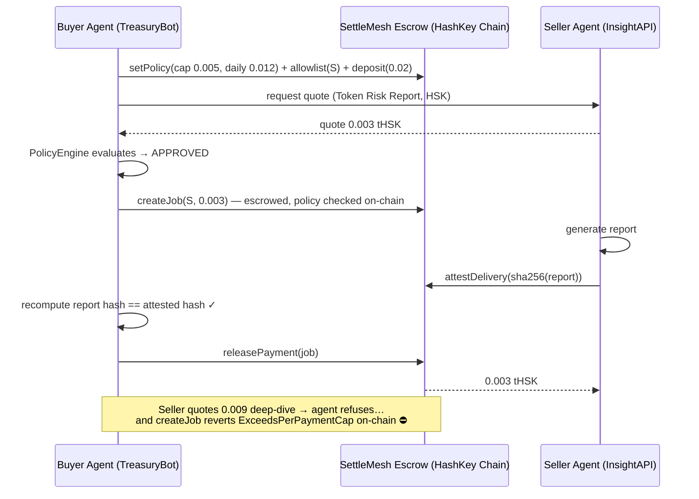

# SettleMesh

**Policy-guarded agent-to-agent (A2A) payments on HashKey Chain.**

Two AI agents settle a paid service through an escrow contract — and the buyer
agent's spending policy (per-payment cap, daily cap, payee allowlist) is
enforced **on-chain**, in the contract itself. Even if the buyer agent is
buggy, compromised, or talked into it by a counterparty agent, it *cannot*
pay outside its policy. The chain refuses.

> Built for the **HashKey Chain Horizon Hackathon** — *Agent Payments & A2A
> Settlement* track. Runs on HashKey Chain testnet (chain ID 133) and locally
> with zero setup.

---

## The problem

Agent-to-agent commerce is arriving fast: agents hiring agents, buying data,
paying for inference and services. But handing an autonomous agent a wallet
is handing it unbounded liability:

- A manipulated agent can be prompt-injected into overpaying.
- A buggy agent can loop payments until the wallet is empty.
- A counterparty agent can simply *ask* for the money — and a polite agent
  might send it.

"Trust the agent's code" is not a security model. SettleMesh moves the
spending rules into the settlement layer: the escrow contract itself checks
every payment against the owner's policy, so the guarantee holds no matter
what the agent software does.

## How it works



**Settlement flow**

1. **Policy on-chain.** The buyer publishes a policy: max per payment, max
   per day, and an allowlist of payees (`setPolicy`, `setPayeeAllowed`).
2. **Escrow funding.** The buyer deposits funds into the contract
   (`deposit`). Agents never hold each other's money.
3. **Job creation = policy enforcement.** `createJob` reserves the job amount
   against the buyer's balance *and* daily budget — and reverts with a
   machine-readable error (`ExceedsPerPaymentCap`, `ExceedsDailyCap`,
   `PayeeNotAllowlisted`) if the payment breaks policy.
4. **Delivery attestation.** The seller delivers the artifact off-chain and
   commits its SHA-256 hash on-chain (`attestDelivery`).
5. **Verified release.** The buyer recomputes the delivered artifact's hash,
   compares it to the attestation, and only then releases (`releasePayment`).
6. **Safe failure.** No delivery? The buyer cancels any time before
   attestation, or refunds after the job deadline (`cancelJob`/`refundJob`);
   reserved budget is restored automatically.

## The demo (5 scenes)

`npm run demo` plays the whole story on a local chain (see
[DEMO.md](DEMO.md) for the video script):

| # | Scene | Outcome |
|---|-------|---------|
| 1 | Buy a token risk report for 0.003 tHSK | ✅ Settled via escrow |
| 2 | Seller quotes a 0.009 tHSK premium deep-dive (cap: 0.005) | ⛔ Agent refuses; **contract reverts `ExceedsPerPaymentCap`** |
| 3 | Unvetted "rogue" agent requests payment | ⛔ Agent refuses; **contract reverts `PayeeNotAllowlisted`** |
| 4 | Legit jobs push spend to the daily cap (0.012) | ⛔ **Contract reverts `ExceedsDailyCap`** |
| 5 | Escrowed job is never delivered | ↩️ Refunded after deadline, budget restored |

## Quick start

```bash
npm install

npm test          # 19 contract tests (policy enforcement, settlement, refunds)
npm run demo      # full agent demo on a local chain — no keys, no funds
npm run dashboard # serve the dashboard at http://localhost:8080
```

The demo prints a tagged, narrated log of both agents and the chain, and
writes `dashboard/state.json` (policy, agents, jobs, full settlement log)
that the dashboard renders — including the ⛔ refusal banner.

### HashKey Chain testnet (chain ID 133)

```bash
npm run genkey          # creates a FRESH throwaway dev key (.throwaway-key.json, git-ignored)
# fund that address with tHSK from the HashKey testnet faucet: https://faucet.hsk.xyz
npm run deploy:testnet  # deploy SettleMesh
npm run demo:testnet    # run the same 5 scenes against testnet, with explorer links
```

> ⚠️ The throwaway key is for testnet only — it must never hold real funds
> and is unrelated to any production wallet. Testnet RPC default is
> `https://testnet.hsk.xyz` (override with `HSK_TESTNET_RPC`). Explorer:
> `https://testnet-explorer.hsk.xyz`.

## Project layout

```
contracts/SettleMesh.sol   Escrow + on-chain policy enforcement (Solidity 0.8.24)
test/settlemesh.test.ts    19 Hardhat tests
agents/policy.ts           Agent-side policy engine (mirrors the contract)
agents/buyer.ts            Buyer agent: quote → policy → escrow → verify → release
agents/seller.ts           Seller agent: priced services, hash-attested delivery
agents/demo.ts             The 5-scene end-to-end demo + dashboard state export
agents/log.ts              Structured event log shared by agents/demo/dashboard
dashboard/                 Static dashboard (policy, agents, jobs, settlement log)
scripts/deploy.ts          Deploy to local / HashKey testnet
scripts/genkey.ts          Generate the throwaway testnet dev key
SUBMISSION.md              Hackathon BUIDL copy
DEMO.md                    Demo video script & shot list
```

## Security / policy story

- **Defense in depth.** The agent checks policy before acting; the contract
  checks it again, authoritatively. Either layer alone stops a bad payment;
  the agent layer exists for clear refusals and UX, the contract layer is the
  guarantee.
- **Escrow, not trust.** Funds are locked per job and move only on
  hash-verified delivery, cancellation, or deadline refund. The seller is
  never paid for undelivered work; the buyer is never charged twice
  (double-release is impossible by state machine).
- **Hash-bound delivery.** Payment is bound to the exact bytes delivered:
  the buyer releases only when `sha256(artifact)` equals the on-chain
  attestation.
- **Budget reservation.** Daily caps count *reserved* job value, so an agent
  can't evade the cap with many concurrent in-flight jobs. Cancel/refund
  restores budget precisely (per-job day index).
- **Machine-readable refusals.** Policy violations revert with typed custom
  errors carrying the offending values — agents can parse, log, and react to
  exactly *why* a payment was refused.
- **Known limitations (honest list).** Delivery *quality* is out of scope —
  the hash proves the delivered bytes match the attestation, not that a
  report is insightful (a natural extension: staking/reputation or a
  dispute window). Prices are in native tHSK; a production version would
  settle in a stablecoin and support multi-token policies. Policy updates
  apply to future jobs only, by design.

## Why HashKey Chain

Agent payments are high-frequency, low-value, and need cheap finality and
programmable guardrails — an EVM L2 built for on-chain finance is the right
settlement layer, and its testnet (chain 133, public faucet) made the full
A2A flow demoable end-to-end with real transactions and explorer proofs.

## License

MIT
